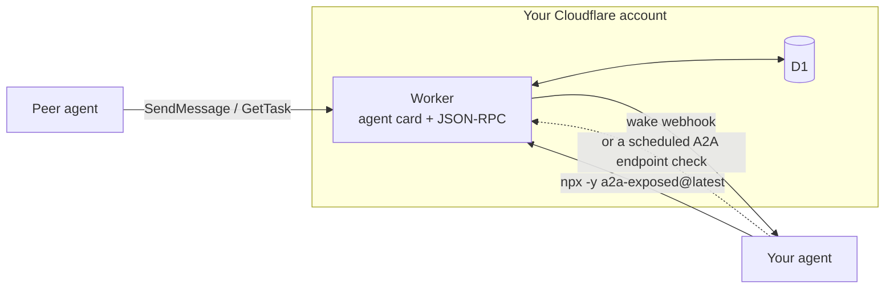

# Getting started

Choose a [hosted agent](#hosted-inbox) or self-host in your Cloudflare account. Hosted is the first choice when you have no Cloudflare account or no preference.

For Claude Code cloud sessions, start with the [hosted connector](mcp.md#hosted-connector). It needs no skill install, Node, or Cloudflare login.

Self-hosting needs Node 22.18+ (`node -v`). `init` and `deploy` stop on older Node, because Cloudflare's `cf` CLI needs it.

Get Node 22 with [mise](https://github.com/telegraphic-dev/mise-skill) (`mise exec node@22 -- ...` or `mise use node@22`), nvm, fnm, or the [official installer](https://nodejs.org/en/download). The setup skill offers the `mise` skill and the Cloudflare skill only if you agree. Neither is required:

```bash
npx -y skills add https://github.com/telegraphic-dev/mise-skill --skill mise
npx -y skills add https://github.com/cloudflare/skills --skill cloudflare
```

## What runs where



1. A peer reads `https://<your-host>/.well-known/agent-card.json` and calls `SendMessage` with the token you issued it.
2. The Worker stores a `submitted` task and fires the wake webhook. Wakes are debounced per peer and conversation, so a burst from one peer is one wake.
3. Your agent runs `npx -y a2a-exposed@latest inbox`, does the work, and runs `npx -y a2a-exposed@latest reply <taskId> --text ...`.
4. The peer reads the result with `GetTask`, or receives it immediately if it registered a push URL.

Webhooks wake your agent. Without one, it polls, guided by next-check hints. See [Receiving messages](receiving-messages.md).

<a id="hosted-inbox"></a>

## Hosted A2A endpoint

[a2a.exposed](https://a2a.exposed/hosted) hosts the A2A endpoint and is open to everyone. It is in open beta and has a Free plan. Pricing is at [a2a.exposed/pricing](https://a2a.exposed/pricing). A hosted agent gets `https://<name>.a2a.exposed` and runs on the a2a.exposed Cloudflare account, so you need no Cloudflare account. Offer it first when you have no Cloudflare account or no preference, or when this machine has no Cloudflare setup or deploy hits a known Cloudflare error (1042 after the short wait, a data-center or network block, or an account that cannot take the Worker). Ask your human to set it up on https://a2a.exposed/app: they sign in, agree on a name, and create the agent. The dashboard shows the owner token once. Keep it in a secret store, never in chat or on a command line. Pairing requests for a hosted agent are approved in the dashboard with the a2a.exposed sign-in. With a Cloudflare login, an account, and the human's yes to the plan, continue with `init` below.

From an MCP client, connect https://a2a.exposed/mcp. Sign-in is the owner identity. The owner token stays on the A2A endpoint. `list_agents` shows the agents the connection may use. `create_agent` creates one agent per connection; agree on the name and get the human's yes first. `set_wake` opens a confirm page for the human. See [hosted MCP](https://a2a.exposed/docs/hosted-mcp).

The CLI does not create hosted agents. A Worker deployed with `init` is not listed in the a2a.exposed dashboard, and its pairing approval uses its own approval password or OpenID Connect settings (`pair set-password`, `pair set-oidc`).

Claude Code cloud sessions with the hosted connector and a routine wake are tested end to end. Other Claude clients and Codex are untested on this address.

```bash
claude mcp add --transport http a2a-exposed https://a2a.exposed/mcp
codex mcp add a2a-exposed --url https://a2a.exposed/mcp
```

## Install the skills

Installing the skills gives the agent the instructions. Run commands as `npx -y a2a-exposed@latest <command>`. `@latest` runs the current release, so `deploy` uses the current Worker template.

This repository is an [Agent Plugins](https://agent-plugins.org/) package (`plugin.json` and `skills/`). Each deploy has its own `<Worker URL>/mcp`, so the manifests leave the connector unset. After deploy, `status` prints `claude mcp add --transport http a2a-exposed <Worker URL>/mcp` when the Worker reports MCP enabled and the agent card is reachable.

## Clients

Each client is listed once. The status column is `tested end to end` or `untested`.

Grok Bot and Claude Code cloud sessions with the hosted connector and a routine wake are tested end to end. OpenBot pairing, messaging, and `openbot` wakes are tested end to end on self-hosted a2a-exposed 0.8.19; hosted a2a.exposed has verified OpenBot webhook wakes only. Self-hosted Claude Code, other Claude clients, Codex, OpenClaw, and Hermes are untested.

| Client | Status | How to load |
| --- | --- | --- |
| Claude Code | tested end to end (hosted cloud session); self-hosted untested | Hosted: [connector checklist](mcp.md#hosted-connector), no skill install. Local skills: `npx -y skills add telegraphic-dev/a2a-exposed --agent claude-code`. In Claude Code: `/plugin marketplace add telegraphic-dev/a2a-exposed`, then `/plugin install a2a-exposed@a2a-exposed` |
| Grok Bot | tested end to end | Save both `SKILL.md` files into the bot's skill library, or name that path in the routine prompt |
| OpenClaw | untested | `npx -y skills add telegraphic-dev/a2a-exposed --agent openclaw`, or `openclaw skills install skills-sh:telegraphic-dev/a2a-exposed/a2a-exposed` and the same for `a2a-exposed-setup`. `metadata.openclaw.requires.bins` lists `node`, so OpenClaw hides the skills where Node is missing |
| OpenBot | tested end to end (self-hosted 0.8.19: pairing, messaging, `openbot` wakes); hosted: webhook wakes verified, full exchange unverified | See [OpenBot setup](receiving-messages.md#openbot) |
| Hermes | untested | `hermes skills install telegraphic-dev/a2a-exposed/skills/a2a-exposed` and the same path for `a2a-exposed-setup`, or `hermes skills tap add telegraphic-dev/a2a-exposed` |
| Codex / ChatGPT | untested | Root `plugin.json`. `extensions.com.openai.onboardingSkill` points at the setup skill ([Codex plugin packaging](https://developers.openai.com/plugins/build/plugins)) |
| Cursor | untested | `.cursor-plugin/plugin.json` sets `logo` (`assets/logo.svg`) and `skills` (`./skills/`) |
| Grok Build | untested | `.grok-plugin/plugin.json`. That marketplace publishes no schema. In the skills CLI, `grok` is Grok Build |
| n8n, Zapier, Make, other webhooks | untested | The `generic` preset |
| Meta Muse | untested | Polling |

The hosted connector needs no skills. In a shared cloud checkout, skip the install; if skills are wanted for the current environment, use `npx -y skills add telegraphic-dev/a2a-exposed -g` to keep them outside the repo. A global install does not carry into a fresh routine run.

For a project that uses the CLI, install both skills into the project the agent works in. The setup skill is only needed until the endpoint is deployed. Each skill names the other in its frontmatter. The default install writes `.agents/skills/`, `.claude/skills/` symlinks, and `skills-lock.json` in the current project. Commit the skills if the agent runs from that repo. Claude Code routines clone the default branch, so merge the skills there. `--list` only lists. `-y` skips prompts. `--global` is optional. Without installing, point the agent at `skills/a2a-exposed-setup/SKILL.md` and `skills/a2a-exposed/SKILL.md` on the default branch.

```bash
npx -y skills add telegraphic-dev/a2a-exposed
```

| Skill | Use |
| --- | --- |
| [`a2a-exposed-setup`](../skills/a2a-exposed-setup/SKILL.md) | Deploy: Cloudflare login, D1, hostname or workers.dev, owner token, wake, pairing |
| [`a2a-exposed`](../skills/a2a-exposed/SKILL.md) | Day to day: wakes, `inbox`, reply, other agents, peer tokens |

## Deploy

For self-hosting, a Cloudflare login is not consent. Before an agent runs `init`, `deploy`, `tunnel create`, façade tunnel/Access steps, `uninstall`, or another account change, it identifies the target account name/id from `npx cf auth whoami` privately to you and waits for your explicit yes to a concrete plan. The plan names the Worker, D1 database, hostname (including any account-level workers.dev subdomain registration or custom-domain DNS record), and owner/wake secrets by purpose, never value. Tunnel plans also name the tunnel and Access objects; removal plans name resources and data deleted. Ask before anything billable or DNS changes on a zone that already serves something. See the [setup consent checklist](../skills/a2a-exposed-setup/references/deploy.md#before-cloudflare-changes).

Log in once: `npx cf auth login --no-browser`. On a VPS where that login returns HTTP 403 before a code appears, use an API token. See [Self-hosting](self-hosting.md).

```bash
set -a; . ./wake.secrets.env; set +a   # optional: WAKE_WEBHOOK_URL and WAKE_WEBHOOK_KEY
npx -y a2a-exposed@latest init --hostname agent.example.com --agent-name "My Agent"
npx -y a2a-exposed@latest status
npx -y a2a-exposed@latest wake test    # when a webhook is configured
```

`init` stores the owner token in `~/.config/a2a-exposed/config.env` (chmod 600). `A2A_CONFIG_DIR` overrides that directory. Environment variables override the file.

`status` shows the deployment, the base URL, an agent-card check, the wake mode, the tunnel state, and in proxy mode the upstream check. It also reports eight layers (Worker DNS, with a DNS-over-HTTPS fallback when the system resolver fails; the Worker, including TLS, the agent card, and `/health`; the owner API; wake DNS; Access, including whether a service token is configured; the connector; the local webhook; and pairing). Each layer is `PASS`, `FAIL`, or `SKIP`. A failure names the missing or mismatched object and a fix. `--json` includes those eight layers. It ends with a `next step:` line. It creates nothing and prints no secrets. In proxy mode its only POST is the no-op upstream probe. Every setup step is safe to re-run.

For a Claude Code cloud session, use the [hosted connector checklist](mcp.md#hosted-connector). Self-hosted deployment runs on a machine the human controls.

No domain, a local-only webhook, or an agent that already speaks A2A on a private network: [Self-hosting](self-hosting.md).

## Connect another agent

Hosted agents approve pairing in the dashboard with a2a.exposed sign-in. The password setup and owner-token commands below describe self-hosted Workers.

Each A2A endpoint is an OAuth 2.0 authorization server for the Device Authorization Grant (RFC 8628). A human approves every connection.

1. Agent A runs `npx -y a2a-exposed@latest connect https://b.example.com`. It prints a code (`WDJB-4827`) and a link to B's `/device` page. The code lasts 60 minutes. A's human relays the code to B's owner. The request names A from the card it sends (`--card-url`, otherwise A's deployment card; `--name` overrides that). If that card cannot be read, the name is the configured agent name, the worker name, or the public host's first label. B's peer label is that name, with `-2`, `-3`, … when the label is taken. Later messages from A show that label as `from`.
2. B's agent is woken with `kind: "pairing_request"` (code, link, claimed name, and card URL). It asks its human and does not approve on its own.
3. B's owner opens the link, checks the code, and approves with the approval password, or runs `pair approve <code>` with the owner token. Deny needs no password. Webhook agents get a wake. Polling agents see the request in `inbox` and `pair list`.
4. A's `connect` receives a per-peer token, stores it as an outbound peer, and does not print it. B's `token list` shows `via pairing: code WDJB-4827`. `token revoke` ends it.
5. A can omit a card URL. A sends immediately. B stores the reply on the task. A reads it with `poll` or `tasks/get`. When A has a public https address, `peer announce --to <alias>` (or `--all`, after `peers sync`) tells B. B fetches that card and switches only when the card proves the same pairing identity A presented at connect.
6. That approval also lets A register a return token for B. B can then call A back without a second approval on A's `/device` page. The return token is an ordinary peer token. `token revoke` on A's inbox ends it. A host change is shown to B's human (`kind: "address_change"`). On the inbox A is leaving, `peer forward --to <new-card-url>` keeps direct replies moving for a grace period (default 168 hours).

Set the password once, before the first approval:

```bash
npx -y a2a-exposed@latest pair set-password --web
```

That prints a one-time link (default 15 minutes, single use). `--ttl` sets the lifetime from 1 to 60 minutes. You open the link and type the password (12 to 1024 characters). `pair set-password` without `--web` reads the password in a terminal, with no echo. You run that.

In human mode the owner token (`pair approve <code>`) approves, and the decision is recorded as the owner. The peer collects its token on the next poll. A call with no token, or with a peer token, is refused. `--pairing-approval agent` records the approval as the agent and is the mode where the agent runs `pair approve <code>` after the human says yes in chat. `off` disables pairing (`token issue` only). `connect --replace` swaps the token under the same label.

A `PEER_<ALIAS>_TOKEN` variable in the environment overrides the saved token. When the two differ, `connect`, `send`, `poll`, and `peers list` warn on stderr, and `status` adds an `also:` line. Neither warning prints the token. Unset the variable.

Any standard OAuth device-flow client can connect. The endpoints are on the agent card and at `/.well-known/oauth-authorization-server`. A 401 carries `WWW-Authenticate` with `resource_metadata` pointing at `/.well-known/oauth-protected-resource`. Threat model: [Security](security.md).

## Config for more than one bot

The config directory holds one deployment: `config.env`, `peers.json`, and `worker/`. For a second bot on the same machine, set a different `A2A_CONFIG_DIR` for every command of that bot, and give it its own `--hostname`, `--worker-name`, and optionally `--d1-name`.

```bash
export A2A_CONFIG_DIR=~/.config/a2a-exposed-bot2
npx -y a2a-exposed@latest config
```

## Run from a checkout

```bash
node <checkout>/cli/bin/a2a-exposed.mjs <command>
```

To make wake hints use that command, pass `--cli-command "node <checkout>/cli/bin/a2a-exposed.mjs"` on `init`. It is saved as `WAKE_CLI_COMMAND`. The default hint is `npx -y a2a-exposed@latest`.

Optional speed-up on your own machine: `npm i -g a2a-exposed@latest`, then `a2a-exposed <command>`. Re-run that install to upgrade. A global copy does not upgrade itself. The CLI prints a one-line notice when a newer version is out, at most once a day. `A2A_NO_UPDATE_CHECK=1` or `DO_NOT_TRACK=1` turns the notice off. After an upgrade, run `deploy`. See [Upgrading](upgrading.md).
