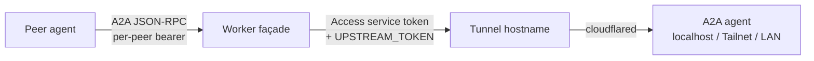

# Self-hosting on Cloudflare

`npx -y a2a-exposed@latest init` deploys the A2A endpoint Worker and a D1 database (Cloudflare's SQLite) into your Cloudflare account, plus the CLI and MCP you run with npx. The owner pages on that A2A endpoint are `/` and `/device`. [a2a.exposed](https://a2a.exposed) hosts the A2A endpoint and is open to everyone. When to use it, and the sentence to say, is in [Getting started](getting-started.md#hosted-inbox). With a Cloudflare login and an account, this page is that A2A endpoint, a tunnel for a local webhook, and a public façade for an agent that already speaks A2A.

The client table is in [Getting started](getting-started.md#clients).

`init` deploys one A2A endpoint. Pass `--hostname` for your own domain, or omit it to serve on `*.workers.dev`.

Secrets go in the environment or a chmod-600 file, never on the command line or in chat:

```bash
set -a; . ./wake.secrets.env; set +a
```

## Cloudflare login

```bash
npx cf auth login --no-browser
```

On some datacenter and VPS addresses, `cf auth login` hits a Cloudflare managed challenge (`Just a moment...`, HTTP 403) on `dash.cloudflare.com` before a device code appears. Use an [API token](https://developers.cloudflare.com/fundamentals/api/get-started/create-token/) instead.

| Deploy | Token permissions |
| --- | --- |
| `--workers-dev` or a workers.dev A2A endpoint | Account → Workers Scripts: Edit. Account → D1: Edit. Account → Account Settings: Read. User → Memberships: Read, so `init` can find the account. Without Memberships, set `CLOUDFLARE_ACCOUNT_ID` or `--account-id` |
| Custom hostname, or `--tunnel` | Those, plus Zone → DNS: Edit (can be limited to that zone). Account → Cloudflare Tunnel: Edit. Account → Access: Apps and Policies: Edit. Account → Access: Service Tokens: Edit |

Workers, D1, Tunnel, and Access are account-scoped. Only DNS can be limited to one zone.

```bash
export CLOUDFLARE_API_TOKEN=...
export CLOUDFLARE_ACCOUNT_ID=...   # when the token can see more than one account
npx -y a2a-exposed@latest init --hostname agent.example.com --agent-name "My Agent"
```

A separate Cloudflare login is a named profile: `npx cf auth create NAME --no-browser`, then `--cf-profile NAME`. It is saved as `CF_PROFILE`. When that profile's `cf auth whoami` lists no accounts, `init` reads `cf accounts list` outside the Worker directory and saves the account when the list has exactly one. Several accounts still need `--account-id`. A failed `cf accounts list` prints cf's error and the exit code when no account id is set. `--account-id` or `CLOUDFLARE_ACCOUNT_ID` is used anyway.

Token errors (Memberships error `1001`, an IP filter that needs both the host's IPv4 and IPv6) are in [Troubleshooting](troubleshooting.md).

## Hostname or workers.dev

```bash
npx -y a2a-exposed@latest init --hostname agent.example.com --agent-name "My Agent"
```

Leave out `--hostname` and the Worker is served at `https://<worker-name>.<account-subdomain>.workers.dev`. This works on the Workers free plan. `init` saves the URL.

Each account has one workers.dev subdomain. If yours has none yet, `init` stops. Pass `--workers-dev-subdomain <name>`, or open the Workers section of the dashboard once, or `PUT /accounts/<account-id>/workers/subdomain` with `{"subdomain":"<name>"}`.

`deploy --workers-dev` moves a custom-hostname deployment to workers.dev. `deploy --hostname <host>` moves it back. The old URL stops serving: its agent card redirects to the new one (301), and everything else returns 410. Peers update their URL.

The agent card always advertises this public base URL. The agent's webhook URL, whether local, on a Tailnet, or on a tunnel, goes in `WAKE_WEBHOOK_URL`. `status` flags a card that points anywhere else. Check the card with `status`. Some agent sandboxes flag `.dev` hostnames in a `curl` command and wait for approval.

`--cron` adds a one-minute flush of pending wakes. It needs a workers.dev subdomain on the account. Pending wakes are also flushed on every request, so the cron is optional.

`init` is safe to re-run. It reuses the saved D1 database, owner token, and settings. To rotate the owner token: `npx -y a2a-exposed@latest init --rotate-owner-token`. That prints the follow-up: update `A2A_OWNER_TOKEN` wherever this A2A endpoint is called, then `peers sync` so uploaded peers stay readable.

Hosted agents (cloud routines and similar) cannot read the local config file. Give them `A2A_BASE_URL` and `A2A_OWNER_TOKEN` as environment secrets, or add the [MCP connector](mcp.md) so the session has no owner token.

## Local webhook

If the agent's webhook only listens locally, `tunnel create` publishes the wake path through a named Cloudflare Tunnel. A Cloudflare Access application on that hostname admits only one service token, held by the Worker. The Worker sends `CF-Access-Client-Id` and `CF-Access-Client-Secret` on every wake, next to the preset's own auth. Keep the agent's own auth enabled.

It needs Cloudflare Zero Trust (the free plan is enough) and a zone somewhere on the account. The A2A endpoint itself can be on workers.dev or a custom hostname. With one zone, `tunnel create` picks `wake-<word>-<word>-<4 hex>.<zone>` and says so. With several, pass `--tunnel-zone <zone>`. With no zone, poll the A2A endpoint instead.

Enable Zero Trust once at <https://one.dash.cloudflare.com/>, or pass `--zero-trust-org <team-name>` to create the organization (`<team-name>.cloudflareaccess.com`). That flag creates DNS, a tunnel, and Access objects. The Zero Trust organization is permanent.

`tunnel create` names three objects `a2a-exposed wake <worker>`: the tunnel, the Access application, and the service token. The Access policy is `a2a-exposed wake: service token only`. The DNS host is `wake-<word>-<word>-<4 hex>.<zone>` unless you pass `--tunnel-hostname`.

Install [cloudflared](https://developers.cloudflare.com/cloudflare-one/networks/connectors/cloudflare-tunnel/downloads/) on the machine that runs the connector. `tunnel create` prints the `cloudflared tunnel run` command.

If `WAKE_WEBHOOK_URL` is already set, run `wake unset` before `tunnel create`. `tunnel create` sets the wake URL to the tunnel hostname. Export `WAKE_WEBHOOK_KEY` (or `WAKE_HMAC_SECRET` for hermes) in that shell: `tunnel create` uploads it with the Access secrets.

```bash
export WAKE_WEBHOOK_KEY='...'          # or WAKE_HMAC_SECRET for hermes. tunnel create sets WAKE_WEBHOOK_URL
npx -y a2a-exposed@latest tunnel create
# hermes:  --tunnel-path /webhooks/<name>     (origin defaults to 127.0.0.1:8644)
# generic: --tunnel-origin http://127.0.0.1:5678 --tunnel-path /webhook/a2a
```

Defaults: `openclaw-*` uses `http://127.0.0.1:18789` and `/hooks/wake` or `/hooks/agent`. The tunnel routes only that path. Other paths return 404.

The connector token is written to `<config dir>/tunnel-token` (chmod 600) and is not printed unless you pass `--show-token`. On the agent's machine, outbound port 7844 (TCP and UDP) to Cloudflare must be open:

```bash
cloudflared tunnel run --token-file ~/.config/a2a-exposed/tunnel-token
```

Copy the token file to that machine if `init` ran elsewhere. Worker secrets show up in about 15 to 40 seconds. Wait about 30 seconds, then check again. For about a minute after `tunnel create`, while the connector reports 0 connections, `status` prints `waiting for the connector to connect`, tells you to start `cloudflared tunnel run --token-file …` now, and exits 0. After that minute, 0 connections is broken. A tunnel status of `inactive` means the connector has never connected.

- `status` shows connector connections, eight layers (`PASS`, `FAIL`, or `SKIP`), and the next step. A failure names the missing or mismatched object. The Access layer says whether a service token is configured and does not print it.
- `tunnel status` checks the Access policy and two probes: a request without the token must be blocked (401/403); with the token, `530` (Cloudflare error 1033) means the connector is not running.
- `wake preview` shows `hasAccessServiceToken: true`. Export `WAKE_WEBHOOK_URL`, `WAKE_WEBHOOK_KEY`, and `WAKE_HMAC_SECRET` in that shell so the fingerprints can match.
- `wake test` sends a wake through Access and the tunnel.

`tunnel rm` prints one line for each object it removes: the Worker secrets (`WAKE_ACCESS_CLIENT_ID`, `WAKE_ACCESS_CLIENT_SECRET`, `WAKE_WEBHOOK_KEY`, `WAKE_HMAC_SECRET`, and `WAKE_WEBHOOK_URL` when that URL is the tunnel's), the DNS record for the wake host, the tunnel `a2a-exposed wake <worker>`, the Access application of that name, the service token of that name, and the local token file. Stop `cloudflared` afterwards. The service token expires after a year: `tunnel rm`, then `tunnel create`. While a tunnel exists, `deploy` and `wake set` refuse a different `WAKE_WEBHOOK_URL`.

Already have an Access-protected URL? Export `WAKE_ACCESS_CLIENT_ID` and `WAKE_ACCESS_CLIENT_SECRET` with `WAKE_WEBHOOK_URL`, then `wake set`. The Worker sends the same headers.

`init ... --tunnel` deploys the A2A endpoint and then creates the tunnel. If the tunnel step fails, the A2A endpoint is already deployed. Fix the error and run `tunnel create`, or read `status`.

<a id="public-facade"></a>

## Public façade

Use this when the agent already serves A2A JSON-RPC (1.0 or 0.3) on a private address (a Tailnet name such as `*.ts.net`, a LAN address, or localhost). The Worker becomes a public façade. Peer calls are checked, then forwarded. The A2A endpoint stays empty.



The Worker cannot reach a private address. Publish the agent on a Cloudflare Tunnel hostname, and lock that hostname with Access so only the Worker's service token is admitted. `init` and `deploy` refuse a private `--upstream`.

1. Create the tunnel and the Access app with `cloudflared` (a zone on the account, Zero Trust enabled). One Access policy: Service Auth for one service token. A request without that token must be refused. The full ingress example is in the setup skill, [deploy reference](../skills/a2a-exposed-setup/references/deploy.md#already-have-a2a-on-a-tailnet-or-lan-expose-it-through-a-public-façade).

2. Deploy the façade. Credentials come from the environment only:

   ```bash
   export UPSTREAM_ACCESS_CLIENT_ID='...' UPSTREAM_ACCESS_CLIENT_SECRET='...'
   export UPSTREAM_TOKEN='...'
   npx -y a2a-exposed@latest init --hostname agent.example.com \
     --upstream https://agent-upstream.example.com/a2a
   npx -y a2a-exposed@latest upstream verify
   ```

   The Access service token gets the Worker through the tunnel. `UPSTREAM_TOKEN` is the bearer the agent itself checks. `init` and `deploy` read the upstream card. Unless that card declares no bearer auth, `UPSTREAM_TOKEN` is required: exported, piped with `--upstream-token-stdin`, or typed at a hidden prompt on a terminal. A non-interactive run without it exits 1 and says what to do. `--no-upstream-token` skips the check when the agent accepts calls with no bearer.

   `--upstream-card-url` defaults to `<upstream origin>/.well-known/agent-card.json` and must be on the `--upstream` origin. The Worker sends the upstream credentials on that fetch. Another origin is refused. `deploy --upstream none` switches back to the A2A endpoint.

3. Pairing stays on the façade. Messages go to the upstream, so `inbox` stays empty. A wake webhook is optional and only announces pairing requests.

`upstream verify` (also part of `status`) checks the path in layers and creates no task:

1. An unauthenticated call to the façade must get 401.
2. `POST /owner/facade/verify` calls the upstream with the stored secrets, using a JSON-RPC method that does not exist. The secrets never leave the Worker.

It reports Access (credentials missing or refused), the agent's bearer (missing or refused), tunnel or network down, or the app reachable (JSON-RPC `-32601`). Peers only see a generic `-32603` with HTTP 502. That error names no secret and no upstream host. The reason is in the Worker log as `upstream_error` and in `status`.

### Card rewrite

Interfaces point at the façade's public URL. Security schemes and OAuth URLs are the façade's. Name, skills, and version come from the upstream card, unless `--agent-*` or `--provider-*` overrides them. A public https `A2A_DOCUMENTATION_URL` in `config.env` is the documentation link on the card. Private, Tailnet, LAN, localhost, and tunnel-hostname URLs are removed. `signatures` are dropped. The A2A endpoint card (no `--upstream`) scrubs the same fields on the description, skills, provider URL, and documentation URL.

The façade forwards `SendMessage`, `GetTask`, and `CancelTask` (1.0 and 0.3). Another peer's task returns `-32001`. An unknown or unrecorded context returns `-32602`. `ListTasks` returns `-32004`. Push notification config calls return `-32003`. Peers poll `GetTask`. Streaming returns `-32004`. The card advertises only the JSON-RPC versions the upstream card lists.

The façade holds one upstream identity and passes the peer label in `X-A2A-Peer`. It records which peer created each task and context. An unrecorded context id is refused. A peer starts a conversation without `contextId` and reuses the one the agent returned.

While you are still building the façade, a private agent can connect outward: `connect https://b.example.com --card-url https://agent.example.ts.net/.well-known/agent-card.json`. A private https card is sent as informational. The other owner's `/device` page flags it as not publicly reachable. A non-https card is left out. Replies come back with `poll` until the façade is up.

<a id="remove-an-inbox"></a>

## Remove an A2A endpoint

`config` prints the config directory and the saved `A2A_WORKER_NAME`, `A2A_D1_ID`, `A2A_D1_NAME`, `A2A_TUNNEL_TOKEN_FILE` (the path), `A2A_TUNNEL_SECRETS_AT` (the value), and `CF_PROFILE`.

`uninstall` prints the plan, then removes the Worker, then the wake tunnel when the config has one (the same objects as `tunnel rm`), then the D1 database. It skips Worker secrets after it deletes the Worker, finds it already gone, or gets Cloudflare error 10000. It prints one line per step, including when that object is already gone. It asks first. Off a terminal, pass `--yes`. `--dry-run` prints the plan and changes nothing. A failed Worker delete, including Cloudflare error 10000, leaves the D1 database in place while the Worker still exists. The tunnel is still removed when that step succeeds. A DNS-only failure lists the Worker, the tunnel, the Access application, the service token, and the token file under Removed when this run removed them, and names the DNS record under Not removed. When the Worker delete did not happen in this run, the D1 line says it is untouched because the Worker delete did not happen in this run. The summary says what was removed, what was not, and that a rerun is safe. An empty config exits 1 with `nothing is deployed from <config dir>`.

```bash
npx -y a2a-exposed@latest uninstall --yes
```

Stop `cloudflared` afterwards (`cloudflared service uninstall` when it runs as a service). After you delete the Worker, open the dashboard and check that Worker's custom domains and routes, and the zone's DNS, and remove a custom domain that is still listed. `tunnel rm` deletes the wake hostname's DNS record. The account's workers.dev subdomain stays. A Zero Trust organization created with `--zero-trust-org` is permanent.

The config directory stays. It still holds the owner token, `WAKE_*` values, peer tokens, and the Worker project (`~/.config/a2a-exposed`, or `A2A_CONFIG_DIR`). A later `init` reuses the owner token. Remove that directory when those should go too.

To delete the Worker and the database with `cf` yourself, run the commands from `<config dir>/worker`. From any other directory, create the cache directory first (`mkdir -p .cloudflare/cache`), or `cf` exits with `EACCES: mkdir '.../node_modules/.cache/cloudflare'`. Add `--profile <CF_PROFILE>` when the login is a named profile.

```bash
npx cf workers delete <A2A_WORKER_NAME> --force
npx cf d1 delete <A2A_D1_ID> --force
```

When the config is gone, remove the tunnel, the Access application, the service token, and the DNS record from the dashboard or with `cf`. The names are `a2a-exposed wake <worker>`.

In the Cloudflare dashboard, open the sections for Tunnels, Access applications, Access service tokens, and the zone's DNS records. Also check that Worker's custom domains and routes.

```bash
npx cf tunnels list
npx cf tunnels connections cleanup <tunnel-id> --force
npx cf tunnels delete <tunnel-id> --force
npx cf zero-trust access applications list
npx cf zero-trust access applications delete <app-id> --force
npx cf zero-trust access service-tokens list
npx cf zero-trust access service-tokens delete <token-id> --force
npx cf dns records list -z <zone-id>
npx cf dns records delete <record-id> -z <zone-id> --force
```
